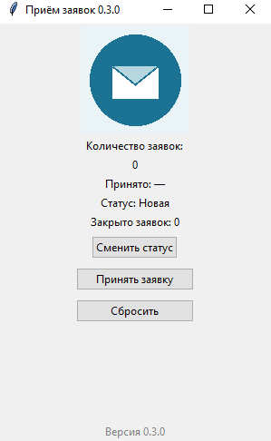
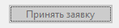
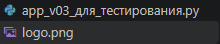
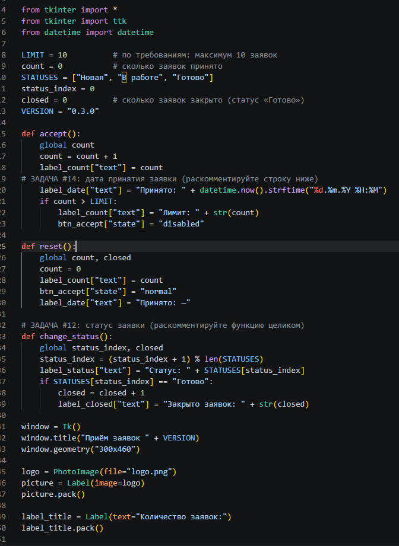

## Приложение «Приём заявок»

приложение для приёма заявок с лимитом 10 штук, сменой статуса и счётчиком закрытых заявок.
 
 
## что умеет

- кнопка «принять заявку» увеличивает счётчик на 1
- лимит 10 заявок: после 10-й кнопка блокируется, появляется надпись «лимит: 10»
- 
- кнопка «сбросить» обнуляет счётчик и дату, кнопка «принять заявку» снова работает
- кнопка «сменить статус» меняет статус по кругу: новая > в работе > готово > новая
- при статусе «готово» увеличивается счётчик закрытых заявок
- после приёма заявки показывается дата в формате дд.мм.гггг чч:мм

- в заголовке окна и внизу отображается версия программы
 
- кнопки крупные, текст читается

## требования

- python 3.7 или новее
- файл logo.png в той же папке, что и программа

## как запустить

1. убедитесь, что установлен python 3.7+
2. положите файл logo.png рядом с app_v03_для_тестирования.py
3. откройте терминал в папке с программой  
4. откройте терминал в папке с программой 

5. запустите программу  
